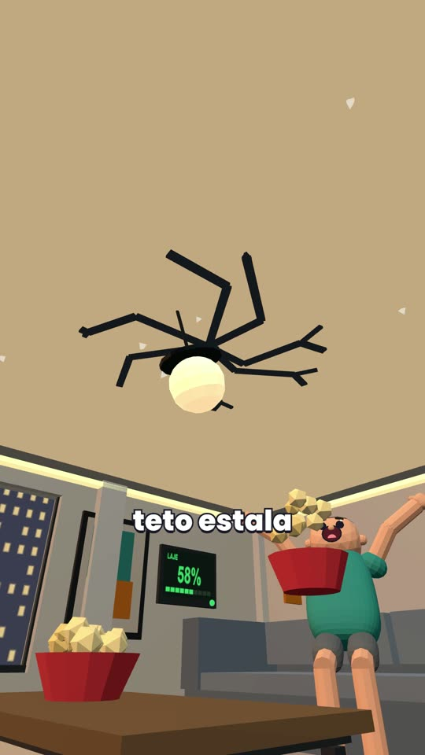
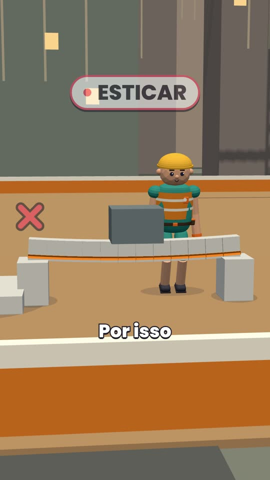
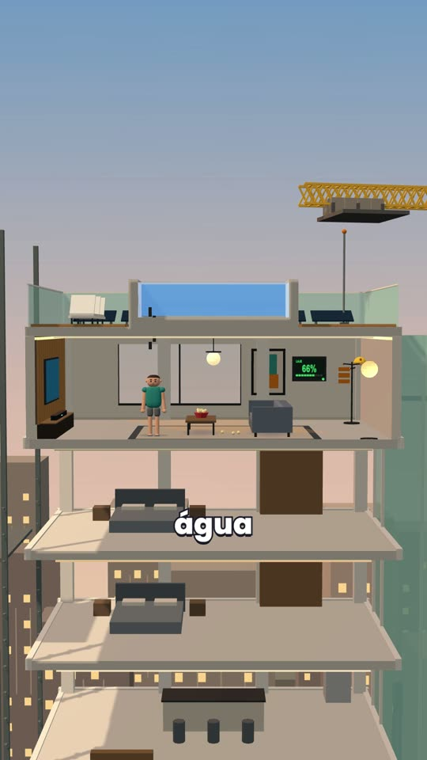
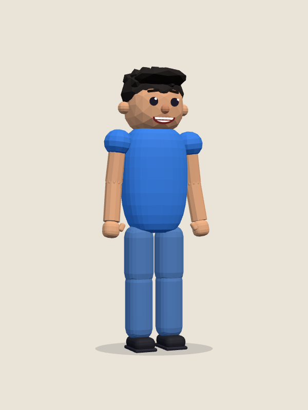
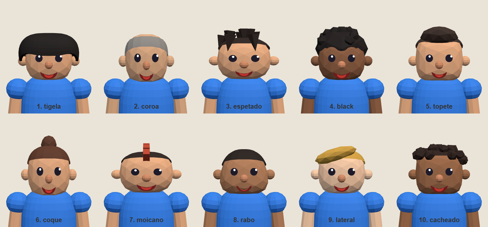
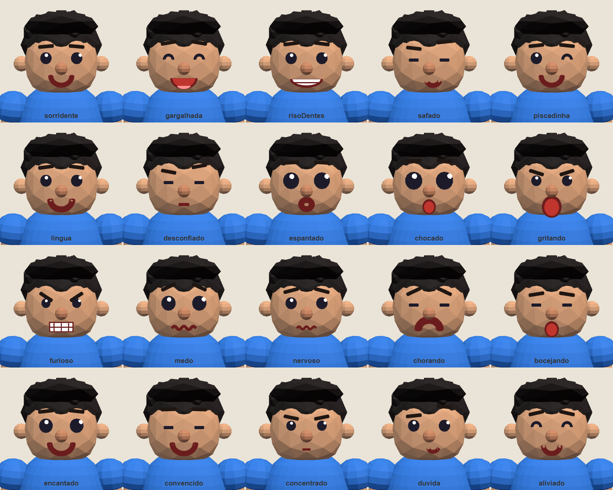
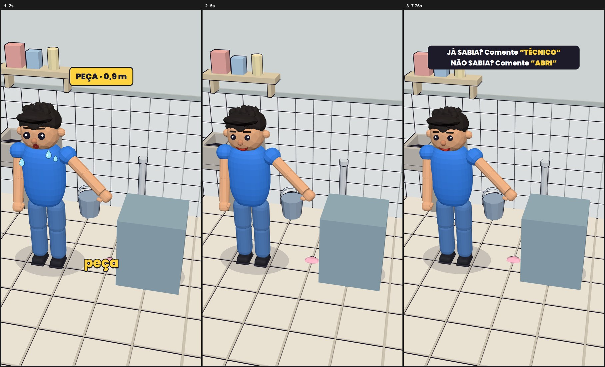

# Estúdio de vídeos explicativos em 3D low poly

Repositório de produção de vídeos: vídeos verticais (9:16, 1080 × 1920, 30 fps) para YouTube Shorts, TikTok e Instagram Reels, que explicam como as coisas funcionam com **causa e efeito**, mecanismos 3D low poly de brinquedo e um personagem fixo, o **Zé**.

Tudo é código: cenas em **Three.js**, animação em **GSAP**, composição e render em **[HyperFrames](https://hyperframes.heygen.com)** (HTML renderizado para vídeo), som procedural em Python e conferência com **FFmpeg**. Nenhuma API paga é necessária.

> O repositório entrega o **método e as ferramentas** (pipeline com portões, biblioteca de ativos, receita editorial, papéis de equipe, testes). Os MP4 dos vídeos publicados **não** estão aqui; ver [O que não está incluído](#o-que-não-está-incluído).

## Como fica o resultado

Quadros do vídeo de exemplo (`exemplos/13-piscina-no-topo`), produzido inteiramente com este repositório:

| Abertura | Mecanismo | Cenário |
|---|---|---|
|  |  |  |

O **Zé**, personagem do projeto, e os 10 estilos de figurantes que usam o mesmo corpo:

| Zé (padrão) | Figurantes |
|---|---|
|  |  |

O Zé tem **31 expressões de rosto**; esta folha mostra 20 delas:



E o que um projeto novo já traz pronto, sem escrever nada (cenário, Zé, legenda, etiqueta, ícones e pedido de comentário, tudo no `modelo-video/`):



---

## Sumário

1. [Como o repositório funciona (visão rápida)](#como-o-repositório-funciona-visão-rápida)
2. [Requisitos e instalação](#requisitos-e-instalação)
3. [Primeiros passos (10 minutos)](#primeiros-passos-10-minutos)
4. [Mapa de pastas](#mapa-de-pastas)
5. [O workflow, etapa por etapa](#o-workflow-etapa-por-etapa)
6. [Criar o primeiro vídeo (passo a passo)](#criar-o-primeiro-vídeo-passo-a-passo)
7. [Voz e tempo por palavra](#voz-e-tempo-por-palavra)
8. [Takes, partitura e câmera](#takes-partitura-e-câmera)
9. [Biblioteca de ativos](#biblioteca-de-ativos)
10. [Som](#som)
11. [Conferência, aprovação e render final](#conferência-aprovação-e-render-final)
12. [Estado, hashes e invalidação](#estado-hashes-e-invalidação)
13. [Equipe e uso com agentes de IA](#equipe-e-uso-com-agentes-de-ia)
14. [Receita editorial](#receita-editorial)
15. [Testes](#testes)
16. [Vídeo de exemplo](#vídeo-de-exemplo)
17. [O que não está incluído](#o-que-não-está-incluído)
18. [Licença e terceiros](#licença-e-terceiros)

---

## Como o repositório funciona (visão rápida)

```
tema ──► esqueleto ──► roteiro ──► plano visual ──► voz ──► P0 ──► P1 ──► P2 ──► montagem ──► P3 ──► render ──► P4 ──► entregue ──► retro
        (aprovação)   (aprovação)  (aprovação)    (você grava)  produção interna (gates com prova)   (aprovação)         (conferir MP4)
```

- Cada vídeo é uma **pasta numerada** em `videos/<NN>-<slug>/`, criada por `ferramentas/novo_video.py` a partir de `modelo-video/`.
- O andamento de cada vídeo fica em `estado.json`. **`ferramentas/pipeline.py` é o guardião**: só deixa avançar de etapa se a anterior tem as aprovações e as provas exigidas, e impede o render final sem aprovação explícita do corte.
- A **biblioteca** (`biblioteca/`) guarda tudo o que se reaproveita: personagem, cenários, objetos, efeitos, câmera, identidade visual. Cada vídeo recebe uma **cópia com hash** dessa biblioteca (`kit/`), então um vídeo antigo sempre se reconstrói igual.
- A **receita editorial** (`receitas/receita-unificada.md`) define como escrever, filmar e revisar. O **workflow mestre** (`WORKFLOW_MESTRE.md`) define a ordem, os comandos e as evidências.
- Humanos e agentes de IA (Claude, Codex, Gemini) seguem os mesmos arquivos. Os papéis estão em `equipe/`.

Identidade visual do projeto (nunca muda): 3D low poly de brinquedo, 9:16, cores vivas; causa e efeito (falha visível → solução → demonstração → nome técnico); a imagem mostra o que a fala explica; legenda curta; abertura forte; final com o resultado e pedido de comentário.

---

## Requisitos e instalação

| Ferramenta | Versão testada | Uso |
|---|---|---|
| Python | 3.14 (3.10+ deve servir) | pipeline, ferramentas, testes |
| Node.js | 24 | HyperFrames (via `npx`) |
| FFmpeg e FFprobe | qualquer recente, no `PATH` | quadros de prova, medição de som, render |
| Chrome/Chromium | recente | snapshots e render (HyperFrames usa headless) |
| HyperFrames CLI | `0.8.191` (fixada) | `check`, `snapshot`, `preview`, `render`, `transcribe` |
| Playwright (Python) | opcional | só para `ferramentas/renderizar.py` (fotos do Zé e dos objetos em PNG) |

O pipeline usa só a biblioteca padrão do Python: não há `pip install` obrigatório.

Instalação:

```bash
git clone https://github.com/Kataninha/3d-lowpoly.git
cd 3d-lowpoly

# Baixa a CLI fixada uma vez para o cache do npx.
# Os scripts do repositório chamam: npx --offline --no-install hyperframes@0.8.191 ...
npx hyperframes@0.8.191 --version

# Confere que tudo está de pé
python -B -m unittest discover -s ferramentas
```

O texto dos arquivos é sempre **UTF-8**. No Windows, use PowerShell ou Git Bash; os exemplos abaixo funcionam nos dois.

> A versão do HyperFrames é fixada de propósito: o render precisa ser reproduzível. Mudar a versão exige atualizar `package.json` do modelo e rever as provas.

### Como usar o HyperFrames neste repositório

O HyperFrames transforma uma página HTML (a composição do vídeo) em MP4. Você **não** instala nada dentro do repositório: a CLI é chamada por `npx`, sempre na versão fixada.

1. **Uma vez por máquina, com internet:** `npx hyperframes@0.8.191 --version`. Isso guarda a CLI no cache do `npx`.
2. **Depois disso tudo roda offline.** Os scripts usam `npx --offline --no-install hyperframes@0.8.191 ...`. Se aparecer erro de pacote não encontrado, repita o passo 1.
3. Na pasta de um vídeo (`videos/<NN>-<slug>/`) valem estes atalhos do `package.json`:

| Comando | O que faz |
|---|---|
| `npm run dev` | Abre a prévia no navegador, com a linha do tempo da composição. |
| `npm run check` | Valida a composição (estrutura, áudio, contraste, layout). Zero erros é requisito, nunca aprovação. |
| `npm run render -- nome.mp4` | Render final protegido (só depois do P3 aprovado; ver [Conferência](#conferência-aprovação-e-render-final)). |

4. Para olhar quadros sem renderizar o vídeo todo: `npx --offline --no-install hyperframes@0.8.191 snapshot . --at 2,5` (a CLI salva PNGs e uma folha de contato em `.hyperframes/artifacts/snapshots/`).
5. Transcrição local da voz (`transcribe`): veja [Voz e tempo por palavra](#voz-e-tempo-por-palavra).
6. Para entender as regras de composição (atributos `data-*`, trilhas, timeline pausada do GSAP), consulte a documentação do HyperFrames em https://hyperframes.heygen.com.

---

## Primeiros passos (10 minutos)

Teste o ambiente com um projeto descartável. Os passos 1 a 3 foram executados neste repositório com o resultado descrito; o passo 4 só abre o servidor de prévia.

```bash
# 1) Cria videos/10-demo a partir do modelo (já traz cenário, Zé, legenda e ícones)
python ferramentas/novo_video.py demo

# 2) Valida a composição com a CLI fixada (esperado: "Check passed", 0 erros)
cd videos/10-demo
npx --offline --no-install hyperframes@0.8.191 check

# 3) Gera quadros em 2 s e 5 s (e no fim) para você olhar
npx --offline --no-install hyperframes@0.8.191 snapshot . --at 2,5

# 4) Abre a prévia no navegador
npm run dev
```

O `check` avisa 3 vezes sobre trilhas densas (`timeline_track_too_dense`, `nested_structure_needs_subcomposition`). São avisos do modelo inicial, não erros.

Quando terminar, apague a pasta `videos/10-demo` (ela é só um teste) antes de criar o primeiro vídeo real com `python ferramentas/novo_video.py <slug>`. Se não apagar, o vídeo real será o 11.

---

## Mapa de pastas

| Pasta / arquivo | Para que serve |
|---|---|
| `WORKFLOW_MESTRE.md` | **Comece aqui.** Etapas, comandos, evidências e regras de fluxo. |
| `receitas/receita-unificada.md` | Receita editorial: roteiro, câmera, visual, som, partitura, portões, checklist. |
| `receitas/decisoes.md` | Decisões permanentes, uma linha cada. |
| `receitas/evolucao.md` | Retrospectiva por vídeo (o que deu errado e o que mudou). |
| `refs/CAMERA.md` | Famílias de câmera (EST, HUM, TRK, MEC, DET, SEC, REL, REV) e critérios de enquadramento. |
| `equipe/` | Um arquivo por papel (Maestro, Modelador-3D, Animador, Acabamento, Revisor-Código, Diretor-Visual) e o `painel.md` (estado vivo). |
| `modelo-video/` | **Único** modelo de produção. `novo_video.py` copia esta pasta. |
| `videos/` | Uma pasta por produção. Mídia pesada fica fora do git (ver `.gitignore`). |
| `biblioteca/` | Ativos reutilizáveis (um item por pasta, com `origem.json`). |
| `ferramentas/` | Scripts Python do pipeline e testes (`test_*.py`). |
| `AGENTS.md`, `CLAUDE.md`, `GEMINI.md` | Instruções para agentes de IA. |
| `.claude/skills/` e `.agents/skills/` | Skill `pipeline-video` (cópias idênticas; `test_docs.py` confere). |
| `CATALOGO.md`, `ATIVOS.md` | Índice dos ativos da biblioteca e onde cada coisa mora. |
| `BUGS.md` | Memória de bugs: ler antes de qualquer tarefa; só se acrescenta, nunca se apaga. |

### Dentro de um vídeo (`videos/<NN>-<slug>/`)

| Arquivo / pasta | Conteúdo |
|---|---|
| `estado.json` | Etapa atual, aprovações, hashes das entradas, histórico (schema 2). |
| `pesquisa.md` | Pesquisa e fontes (toda afirmação técnica precisa de fonte). |
| `esqueleto.md` | Abertura, ciclos, mito, piada, final, cenário detalhado. |
| `roteiro.txt` | Roteiro final (a voz é gravada em cima dele). |
| `plano-visual.md` | Tabela `Tempo \| Fala \| Protagonista \| Câmera \| Zé e motivo \| Peça/efeito \| SFX \| Texto/ícone`. |
| `direcao.md` | Ficha de direção: decisões do vídeo (Zé, ritmo, câmera, mundo, final, experimento). |
| `insumos.json` | Lista de arquivos que só o usuário fornece (voz, amostras). |
| `voz/` | WAV/MP3 da narração e `tempos.json` (tempo por palavra). |
| `takes.json` | Um take por frase: alvo, plano, leitura, tempos, provas. |
| `partitura.json` / `.md` | Partitura de produção gerada a partir de `takes.json` + tempos da voz. |
| `camera.json` | Câmera escolhida por take (a partir de candidatas calculadas). |
| `modelos/`, `montagem-cena.js`, `overlays.js`, `index.html` | Cena Three.js, ações, legenda/overlays e a composição HyperFrames. |
| `kit/`, `kit.manifest.json` | Cópia da biblioteca usada, com SHA-256 de cada arquivo. |
| `qc/` | Relatórios e evidências de P2/P3 (JSON com hashes). |
| `previews/`, `render/`, `som/`, `conferencia/` | Saídas geradas (ignoradas pelo git). |
| `publicacao.md`, `retrospectiva.md`, `registro.md` | Pacote de postagem, retro, diário do vídeo. |

---

## O workflow, etapa por etapa

Ordem fixa. O pipeline só avança com a evidência certa. As etapas (`ferramentas/pipeline.py`):

`esqueleto_pendente → esqueleto_aprovado → roteiro_pendente → roteiro_aprovado → plano_pendente → plano_aprovado → voz → P0 → P1 → P2 → montagem → P3 → render → P4 → entregue → retro`

| Etapa | Quem | O que acontece | Saída / prova |
|---|---|---|---|
| **Tema e esqueleto** | Maestro | Pesquisa fontes, define abertura, ciclos (falha → solução → demonstração → nome), mito, piada, final e **cenário detalhado**. | `pesquisa.md`, `esqueleto.md` |
| **Roteiro** | Maestro | Aplica a receita §1: curto, causa e efeito, uma ideia por frase. Cada ciclo tem limite visível, solução, resultado observável e nome técnico depois da demonstração. | `roteiro.txt`, `insumos.json` |
| **Plano visual** | Maestro | Tabela por tempo + ficha de direção (`direcao.md`). O pipeline recusa ficha com “a decidir”. | `plano-visual.md`, `direcao.md` |
| **Voz** | Usuário | Só depois do roteiro travado. Qualquer mudança de roteiro depois da gravação vira novo take. | `voz/*.wav` |
| **P0** | Maestro | Escolhe famílias de câmera, um experimento por vídeo e o que o público entende em cada frase. | notas em `registro.md` |
| **P1** | Maestro + Diretor-Visual | Escreve `takes.json` e gera a **partitura**; confere intenção de câmera e ações com o plano aprovado. | `partitura.json` |
| **P2** | Modelador-3D + Diretor-Visual | Constrói e testa cada mecanismo isolado; registra objetos reais, avalia câmeras candidatas, monta `camera.json`; revisa snapshots e animatic. | `qc/p2.json` |
| **Montagem** | Animador, Acabamento, Revisor-Código | Cena renderizada a partir de tempo absoluto; legenda, overlays, som; `hyperframes check`, testes de take e de seek. | `index.html` + provas |
| **P3** | Maestro + Diretor-Visual | Abre as provas de ação, vê a prévia a **1 quadro/s** e assiste/ouve tudo. | `qc/p3.json` |
| **Aprovação e render** | Usuário + Acabamento | O usuário aprova o corte; só então o render final roda (comando protegido). | `render/<nome>.mp4` |
| **P4 e entrega** | Maestro | Abre o MP4 final e verifica imagem, áudio, duração, 1080 × 1920, 30 fps. Gera `publicacao.md` e `retrospectiva.md`. | MP4 + pacote de postagem |

Regras de fluxo importantes:

- **Pacote de aprovação:** esqueleto, roteiro e plano visual são apresentados juntos para uma resposta; uma parte rejeitada volta sozinha.
- **Conferir antes de mostrar:** antes de qualquer prévia ir ao usuário, abre-se início/meio/fim de cada take, checa-se legibilidade, oclusão e enquadramento e assiste-se ao vídeo todo a 1 q/s.
- **Limite de rodadas no P2:** após 3 rodadas da mesma prévia sem aprovação, para-se e pede-se decisão de direção antes da 4ª.
- **Portão do P4:** `avancar <video> P4` exige `publicacao.md` e `retrospectiva.md` não vazios.
- **Publicar nunca é automático:** upload exige autorização separada.

---

## Criar o primeiro vídeo (passo a passo)

Rode tudo na raiz do repositório.

```bash
# 1) Cria videos/NN-<slug>/ (a numeração continua a partir da maior existente, mínimo 10)
python ferramentas/novo_video.py meu-tema

# 2) Vê o estado de todos os vídeos e o que está pendente
python ferramentas/pipeline.py status
python ferramentas/pipeline.py pendente

# 3) Escreve esqueleto.md, roteiro.txt, plano-visual.md e direcao.md; registra cada aprovação:
python ferramentas/pipeline.py avancar 10-meu-tema esqueleto_aprovado
python ferramentas/pipeline.py avancar 10-meu-tema roteiro_aprovado
python ferramentas/pipeline.py avancar 10-meu-tema plano_aprovado

# 4) Lista o que só você pode fornecer (voz, etc.)
python ferramentas/pipeline.py insumos 10-meu-tema
```

Comandos do pipeline: `status`, `pendente`, `insumos <video>`, `dispensar <video> <id>`, `iniciar <video>`, `avancar <video> <etapa> [--forcar] [--evidencia qc/arquivo.json]`, `verificar <video> [--etapa ...]`, `aprovar-render <video> --usuario <nome> --evidencia <arquivo>`, `reprovar <video>`, `preparar-voz <video>`.

`<video>` é o nome da pasta (por exemplo `10-meu-tema`). Três reprovações no P3 pausam a produção para revisão.

---

## Voz e tempo por palavra

O áudio da narração é a base do tempo de tudo. A voz é gravada **depois** do roteiro travado e colocada como um único WAV/MP3 em `videos/<video>/voz/`.

```bash
# Normaliza e prepara voz/voz.wav
python ferramentas/pipeline.py preparar-voz <video>

# Transcreve localmente, por palavra, com a CLI fixada (a partir da pasta do vídeo)
npx --offline --no-install hyperframes@0.8.191 transcribe voz/voz.wav --engine parakeet --language pt --no-runtime-install

# Importa os tempos (exige palavras em ordem e correspondência exata com o roteiro)
python ferramentas/importar_transcricao.py videos/<video> videos/<video>/transcript.json

# Gera a partitura com tempos reais
python ferramentas/gerar_partitura.py videos/<video> --voz
```

O importador amarra `voz/tempos.json` ao WAV e ao roteiro por SHA-256. Divergência entre o que foi dito e o roteiro **para o pipeline**: corrija contra o áudio real. Tempos estimados servem só para rascunho.

---

## Takes, partitura e câmera

- **`takes.json`** (escrito pelo Maestro): um item por frase com alvos estáveis (IDs), relações obrigatórias, tipo de plano (`shotType`), o que precisa ser lido (`leitura`), dicas de tempo e palavras de prova.
- **`partitura.json`** é gerada por `gerar_partitura.py`. **O que não está na partitura não existe**; mudar ação visível depois de aprovada exige nova aprovação.
- **Câmera:** `biblioteca/camera/diretor.js` registra objetos Three.js reais (`sceneRegistry`) e calcula candidatas a partir dos limites animados (`planCandidates`). O produtor escolhe 2–3 candidatas onde há ambiguidade, e `selectedCamera(...)` grava `camera.json`. O modelo `montagem-cena.template.js` aplica essas poses.
- Famílias de câmera e critérios de QA (mínimo ~90% da caixa-alvo no quadro útil, margens laterais 6–10%, espaço para legenda) estão em [`refs/CAMERA.md`](refs/CAMERA.md). São **pontos de partida**: sair deles exige motivo escrito na ficha de direção.
- **Provas visuais:** `ferramentas/mapa.py <video>` monta o animatic de meio de take; `ferramentas/provas.py <video> [--preview arquivo]` extrai quadros nos tempos de prova da partitura; `ferramentas/lado_a_lado.py` compara dois vídeos.
- **Determinismo / seek:** a cena é função do tempo (`updateAt(t)`). A prova de seek repete a ordem de quadros 90, 10, 50, 10 e compara hashes: as duas visitas ao quadro 10 precisam ser idênticas.

---

## Biblioteca de ativos

Um item por pasta, com arquivo principal, previews e `origem.json`. Nomes em minúsculas, hífen, sem acento. Ativo usado em dois ou mais vídeos é promovido para cá. Índice completo em [`CATALOGO.md`](CATALOGO.md).

| Pasta | Conteúdo |
|---|---|
| `personagens/ze/` | Zé (versões v2–v4 e **padrão**), movimentos (`moves.js`), 31 expressões de rosto, figurinos. Vídeos novos importam `ze-padrao.js`. |
| `personagens/estilos-cabeca/` | 10 estilos de personagem (NPCs/figurantes) sobre o corpo do Zé. |
| `objetos/` | Carrinho com pneu e macaquinho, grua-torre, guindaste móvel, liquidificador (v1/v2), macaco hidráulico, panela de pressão. |
| `cenarios/` | Cozinha (v1/v2), lavanderia, cobertura de obra. Escala: 1 unidade ≈ 0,5 m. |
| `efeitos/` | Kit de efeitos de cartum: destaque de peça, contorno toon, montagem por unidades, rótulos presos à peça. Guia em `efeitos/EFEITOS.md`. |
| `camera/` | Registro de alvos, candidatas e diagnóstico de enquadramento. |
| `identidade/` | Tokens de cor/tipografia (`tokens.css`, cores `--cor-*` com significado), fontes Poppins, ícones SVG. |
| `vendor/` | Three.js, RoundedBoxGeometry e GSAP (cópias locais para render offline). |

Como um vídeo usa a biblioteca:

1. O item entra em `biblioteca.lock.json` do vídeo.
2. `python ferramentas/sincronizar.py videos/<video> [--copy]` cria `kit/` **sem sobrescrever** arquivos e escreve `kit.manifest.json` com SHA-256 de cada arquivo.
3. Se uma entrada mudar depois de revisada, o estado volta atrás e as aprovações velhas são invalidadas.

Cores: só os tokens `--cor-*` com significado para textos e ícones; teal/laranja do tema são só da marca.

---

## Som

- Os **SFX são gerados por código** (determinísticos): `ferramentas/sons.py <video> <eventos.json>` produz `som/sfx.wav` e `disparos.json`. Não há dependência de bibliotecas de áudio de terceiros nem arquivos de som licenciados no repositório.
- Regra: SFX só nas ações da partitura, no máximo 14 por minuto, sem trilha de música, sem bipes sob a voz. Cada SFX tem uma ação visível no mesmo instante.
- Loudness final: **-14 LUFS ± 0,5**, pico ≤ **-1 dBTP** (`loudnorm` em dois passos). `ferramentas/conferir.py` mede e registra.
- Amostras reais do usuário em `insumos/` têm prioridade sobre as sintéticas.

---

## Conferência, aprovação e render final

```bash
# Hashes atuais das entradas + verificação dos portões
python ferramentas/pipeline.py verificar <video>

# Conferência do corte (a partir da raiz)
python ferramentas/conferir.py videos/<video> --modo P3 --sfx som/sfx.wav

# Aprovar P2/P3: o revisor abre os arquivos de verdade e grava um JSON em qc/
python ferramentas/pipeline.py avancar <video> P2 --evidencia qc/p2.json
python ferramentas/pipeline.py avancar <video> P3 --evidencia qc/p3.json
```

O JSON de revisão precisa de: `resultado: "aprovado"`, `revisor`, `relatorio` (caminho relativo), `arquivos_abertos` (prévia MP4 e imagens de prova) e `inputs_sha256` (os hashes atuais). Se as entradas mudarem, a aprovação deixa de valer.

Depois que **o usuário aprova explicitamente o corte revisado**:

```bash
python ferramentas/pipeline.py aprovar-render <video> --usuario <nome> --evidencia qc/autorizacao.md

# Na pasta do vídeo, com um nome novo de arquivo (nunca sobrescreve render anterior):
cd videos/<video>
npm run render -- final.mp4
```

O wrapper de render (`render_final.py`) verifica hashes e aprovação do P3 antes de chamar a CLI fixada. Prévia: 540 × 960 a 10 fps. Final: 1080 × 1920 a 30 fps (H.264/AAC). Depois do render, abra o MP4, confira imagem e áudio e avance para P4.

Outros comandos úteis na pasta do vídeo: `npm run dev` (prévia no navegador) e `npm run check` (validação do HyperFrames; **zero erros é requisito, nunca aprovação**).

---

## Estado, hashes e invalidação

- Projetos novos usam **schema 2** em `estado.json`.
- Cada etapa guarda os SHA-256 das entradas de que depende (roteiro, voz, takes, câmera, kit…). Mudar `roteiro.txt` volta o vídeo para `roteiro_pendente`; mudar `esqueleto.md` volta para `esqueleto_pendente`, e assim por diante.
- O objetivo é **reprodutibilidade**: um vídeo aprovado se reconstrói a partir de entradas versionadas, configurações e do kit copiado.
- Relatórios novos vão para caminhos versionados (`qc/…-r2.json`), nunca por cima dos antigos.

---

## Equipe e uso com agentes de IA

Os papéis são fixos; o modelo por trás de cada papel é livre (padrão: um modelo forte como Maestro e um mais leve para o resto).

| Papel | Resumo |
|---|---|
| **Maestro** | Líder e produtor. Decide a qualidade, escreve esqueleto/roteiro/plano/partitura, aprova ou reprova, único que fala com o usuário. |
| **Modelador-3D** | Objetos, cenários, o Zé e a mecânica das peças. |
| **Animador** | Executa a partitura: movimentos, ações das peças e câmera. |
| **Acabamento** | Legenda, overlays, som, medições e render. |
| **Revisor-Código** | Audita código e contrato HyperFrames **antes** da revisão visual. Só lê e roda testes. |
| **Diretor-Visual** | Revisão visual somente leitura: abre os quadros de verdade e dá veredito. |

Regras práticas para qualquer agente (detalhes em [`AGENTS.md`](AGENTS.md)):

- Ler `equipe/<papel>.md`, `equipe/painel.md`, `receitas/receita-unificada.md` e `BUGS.md` antes de agir.
- Um agente edita um arquivo por vez (o dono é quem tem a ordem de serviço em `videos/<NN>/tarefas/`).
- Nunca apagar, mover ou sobrescrever arquivos do usuário sem aprovação; saída nova vai para pastas novas.
- Honestidade visual: nunca descrever imagem ou vídeo que não foi aberto de fato.
- Sem APIs pagas. Só assinaturas autenticadas. Publicar, apagar, instalar e custo pedem aprovação.
- Manter `equipe/painel.md`, `videos/<NN>/registro.md` e `receitas/decisoes.md` atualizados.

`CLAUDE.md` e `GEMINI.md` apenas acrescentam particularidades de cada ferramenta e importam `AGENTS.md`. A skill `pipeline-video` (`.claude/skills/` e `.agents/skills/`) dispara o fluxo quando chega um tema.

---

## Receita editorial

[`receitas/receita-unificada.md`](receitas/receita-unificada.md) é a fonte única de qualidade. Em resumo:

- **§0 Portões do usuário:** perguntas, esqueleto, roteiro, plano visual (e como detalhar o cenário).
- **§1 Roteiro:** função fixa, palavras livres; §1.1 *Retrocesso Causal* (voltar ao começo para mostrar de onde vem o problema); §1.2 *Causa e efeito*.
- **§2 Câmera por takes**, **§3 Visual**, **§4 Entradas, textos e ícones**, **§5 Som**.
- **§6 Partitura de produção (P1)**, **§7 Equipe**, **§8 Portões**, **§9 Checklist obrigatório**, **§10 Retro e evolução**.

Princípio: *o que explica é o protagonista; cada vídeo decide como contar.* Números de referência (ciclos, duração, cortes, SFX/min) são pontos de partida, nunca metas.

---

## Testes

```bash
python -B -m unittest discover -s ferramentas
```

Cobrem pipeline e portões, importação de transcrição, geração de partitura, contrato de câmera, mapa de takes, montagem de cena, provas e conferência, direção, documentação (`test_docs.py` garante que as duas cópias da skill são idênticas) e locomoção. Alguns testes sobem um servidor HTTP local e abrem um navegador headless: precisam de Chrome/Chromium instalado.

---

## Vídeo de exemplo

`exemplos/13-piscina-no-topo/` é um projeto completo entregue (“Como colocam uma piscina no topo de um prédio?”), **somente com os arquivos-fonte**: pesquisa, esqueleto, roteiro, plano visual, ficha de direção, `takes.json`, partitura, câmera, modelos 3D (`modelos/cenario`, `modelos/mecanicas`), overlays, relatórios de QC e pacote de postagem. É a melhor referência de como cada arquivo é preenchido.

Ele fica **fora de `videos/`** de propósito: é material de leitura, e o pipeline só enxerga o que está em `videos/`. A pasta `kit/`, a voz, o som e as imagens de prova não estão no repositório, então o exemplo não renderiza como está; use-o para ler e copiar padrões (por exemplo, a organização de `modelos/mecanicas/`).

`videos/` começa vazio. O primeiro vídeo que você criar será o `10-<slug>`. Para ver um projeto rodando de verdade, use os [Primeiros passos](#primeiros-passos-10-minutos): o modelo inicial renderiza uma cena completa com o Zé.

---

## O que não está incluído

- MP4 de vídeos publicados, prévias e gravações de voz (ficam com o autor; `.gitignore` bloqueia `*.mp4`, `*.wav`, `*.mp3`, `*.png`, `*.jpg` fora das exceções de referência).
- Os demais vídeos de produção do autor (10–12 e 14–19).
- Configurações pessoais de ferramentas de IA (hooks e permissões locais).

---

## Licença e terceiros

© 2026. Todos os direitos reservados. Veja [`LICENSE`](LICENSE).

Bibliotecas de terceiros e fontes incluídas em `biblioteca/` estão listadas, com suas licenças, em [`THIRD_PARTY_NOTICES.md`](THIRD_PARTY_NOTICES.md).
